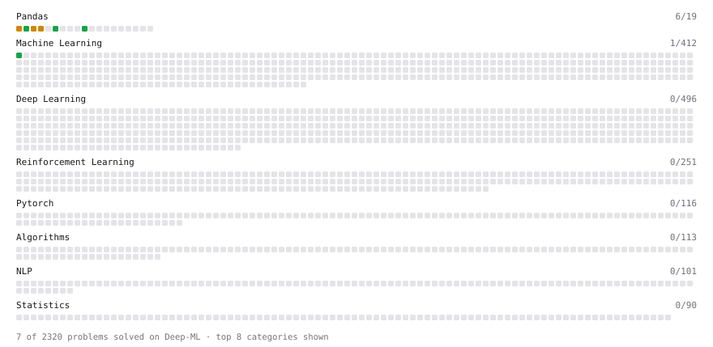

# Deep-ML

My machine learning practice from [Deep-ML](https://www.deep-ml.com). Every solution here was written by hand.

**16** solved · 15 problems · 1 labs · 0 math

[**Browse the interactive portfolio**](https://TheRealFedorDev.github.io/deep-ml/) to replay this filling in over time.

## Problems

| | Difficulty | Solved | |
| --- | --- | --- | --- |
| [Add a Per-Group Average Column with GroupBy Transform](https://www.deep-ml.com/problems/1136) | easy | 2026-11-15 | [solution](problems/1136-add-a-per-group-average-column-with-groupby-transform) |
| [Calculate Mean by Row or Column](https://www.deep-ml.com/problems/4) | easy | 2026-11-16 | [solution](problems/0004-calculate-mean-by-row-or-column) |
| [Feature Scaling Implementation](https://www.deep-ml.com/problems/16) | easy | 2026-11-16 | [solution](problems/0016-feature-scaling-implementation) |
| [Handle Missing Data in pandas (dropna/fillna)](https://www.deep-ml.com/problems/1128) | easy | 2026-11-15 | [solution](problems/1128-handle-missing-data-in-pandas-dropna-fillna) |
| [Linear Regression Using Normal Equation](https://www.deep-ml.com/problems/14) | easy | 2026-11-16 | [solution](problems/0014-linear-regression-using-normal-equation) |
| [Matrix-Vector Dot Product](https://www.deep-ml.com/problems/1) | easy | 2026-11-16 | [solution](problems/0001-matrix-vector-dot-product) |
| [Reshape Matrix](https://www.deep-ml.com/problems/3) | easy | 2026-11-16 | [solution](problems/0003-reshape-matrix) |
| [Scalar Multiplication of a Matrix](https://www.deep-ml.com/problems/5) | easy | 2026-11-16 | [solution](problems/0005-scalar-multiplication-of-a-matrix) |
| [Select Rows and Columns with Boolean Masks](https://www.deep-ml.com/problems/2320) | easy | 2026-11-15 | [solution](problems/2320-select-rows-and-columns-with-boolean-masks) |
| [Transpose of a Matrix](https://www.deep-ml.com/problems/2) | easy | 2026-11-16 | [solution](problems/0002-transpose-of-a-matrix) |
| [Calculate Eigenvalues of a Matrix](https://www.deep-ml.com/problems/6) | medium | 2026-11-16 | [solution](problems/0006-calculate-eigenvalues-of-a-matrix) |
| [Clean a Messy Dataset: Dedup, Standardize, Impute](https://www.deep-ml.com/problems/1131) | medium | 2026-11-15 | [solution](problems/1131-clean-a-messy-dataset-dedup-standardize-impute) |
| [Filter, Group, and Aggregate a DataFrame (Top-10 by Metric)](https://www.deep-ml.com/problems/1127) | medium | 2026-11-15 | [solution](problems/1127-filter-group-and-aggregate-a-dataframe-top-10-by-metric) |
| [Merge Multiple DataFrames](https://www.deep-ml.com/problems/1129) | medium | 2026-11-15 | [solution](problems/1129-merge-multiple-dataframes) |
| [Decision Tree Learning](https://www.deep-ml.com/problems/20) | hard | 2026-11-16 | [solution](problems/0020-decision-tree-learning) |

## Labs

| | Difficulty | Solved | |
| --- | --- | --- | --- |
| [Design Your Own Activation Function](https://www.deep-ml.com/labs/9) | easy | 2026-11-16 | [solution](labs/0009-design-your-own-activation-function) |

---

_This file is regenerated by Deep-ML on every push._
